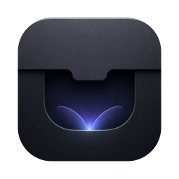
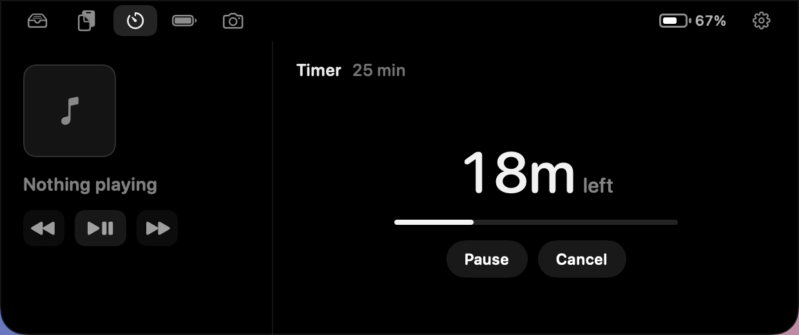
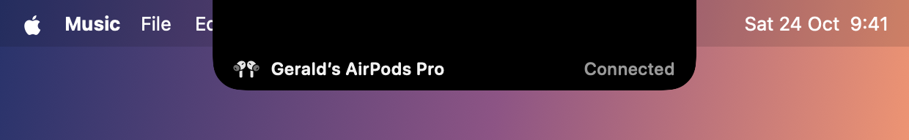
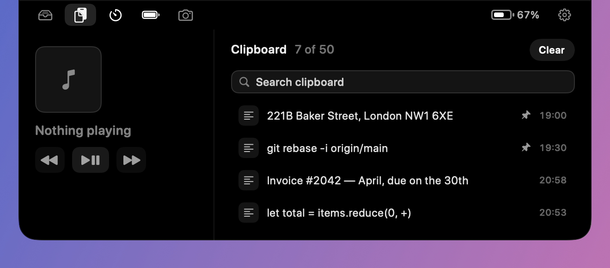
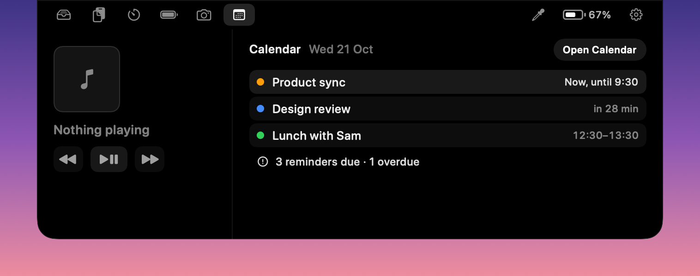
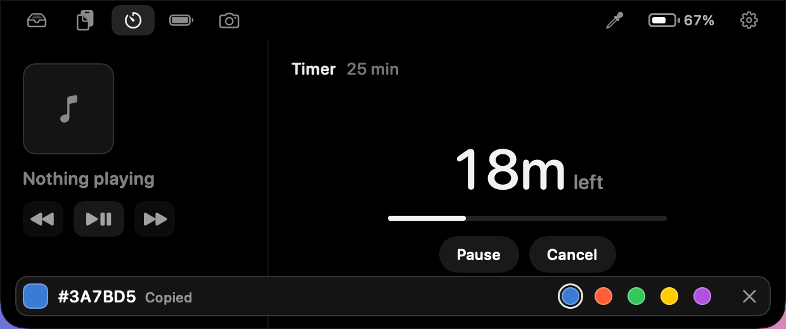
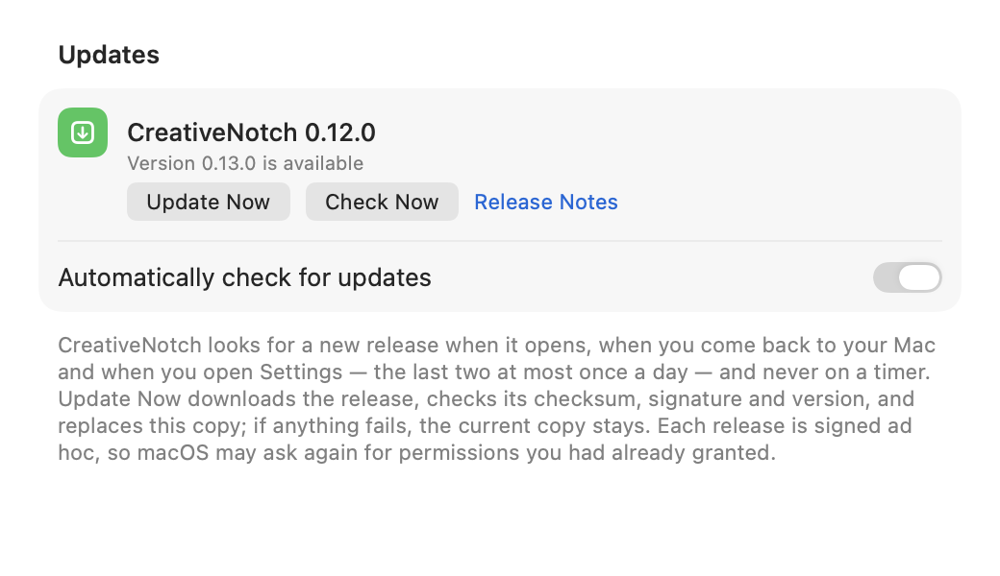
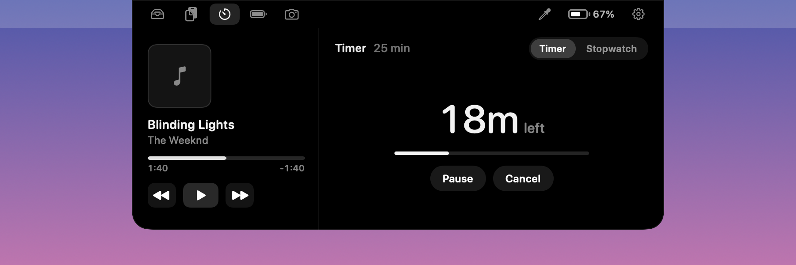
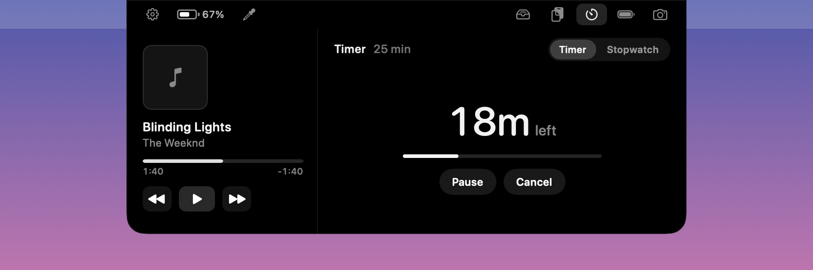

<p align="center">
  
</p>

<h1 align="center">CreativeNotch</h1>

<p align="center">
  Turn the MacBook notch into something useful — without the battery drain.
</p>

<p align="center">
  <a href="https://github.com/GcdZ03/CreativeNotch/actions/workflows/ci.yml">
    
  </a>
  
  
  
  
</p>

<p align="center">
  
</p>
<p align="center"><sub>Rendered offscreen by the test suite's renderer on a stand-in wallpaper, not a screenshot — the layout is exact, the desktop is not.</sub></p>

https://github.com/user-attachments/assets/368c8f11-84fe-4dec-aa86-9deefde1b3f7

<p align="center"><sub>The v0.14 launch video (25s, with sound). Every view of the app in it is a real render from the app's own code; the songs, files, clipboard text, calendar and wallpaper are stand-ins.</sub></p>

---

## Why this exists

There are a dozen notch apps for macOS. The good ones share a flaw: they
poll. Global mouse monitors run continuously, system stats tick on timers,
audio visualisers run FFT on a live tap. Users report idle battery drain as
high as 5%/hour and memory leaks reaching 2 GB.

This is checkable rather than folklore. The most popular open-source notch
app installs **three permanently-resident global event monitors** — on mouse
down, drag and up — in its drag detector alone, plus repeating timers behind
its visualiser and its animated face. Those are the exact constructs
[`docs/ARCHITECTURE.md`](docs/ARCHITECTURE.md) names as not allowed here.

CreativeNotch inverts that with a single architectural commitment:

> **No subsystem runs when it isn't needed, and that rule is enforced
> centrally rather than trusted to each module.**

Everything else follows from it. Hover uses an `NSTrackingArea` on the panel
instead of a global monitor. Screen following listens for notifications
instead of tracking the cursor. The one subsystem that genuinely cannot
avoid polling — clipboard history, because `NSPasteboard` has no change
notification — is gated centrally on system activity rather than trusted to
behave.

Built for its author's daily use, and free for anyone to install with one
command. It is not sold, and it is not on the App Store.

---

## Status

**The foundation is complete. All thirteen modules are built, and every one of them can be switched off.**

| | |
|---|---|
| ✅ Panel anchored to the notch, or a pill on notchless Macs | Built |
| ✅ Hover to peek, click to open — or, in Settings, open on hover with a delay | Built |
| ✅ Follows the focused screen — or, in Settings, stays on the built-in display or a display you name | Built |
| ✅ Menu bar item | Built |
| ✅ **File shelf** — drag files in, drag them out | Built |
| ✅ Media controls | Done |
| ✅ Clipboard history | Done |
| ✅ **Clipboard search and pins** — filter the history as you type; pin up to ten entries to the top | Done |
| ✅ **Media metadata** — now-playing title, artist, artwork, playback position, and an ambient badge | Done |
| ✅ **Battery and power state** — level, charging state, Low Power Mode | Done |
| ✅ **Timer** — a countdown, counting down in the notch | Done |
| ✅ **Stopwatch and multiple timers** — up to three countdowns at once, and a stopwatch with laps, in the timer tab | Done |
| ✅ **Preferences** — switch any module off, and its subsystem stops | Done |
| ✅ **Global shortcut** — open the notch from anywhere, without a global monitor | Done |
| ✅ **Camera** — a mirror under the lens, a shutter, and a record button | Done |
| ✅ **Capture indicator** — when another app is using your camera or microphone | Done |
| ✅ **Bluetooth alerts** — a glance when AirPods, headphones or a speaker connect or disconnect (off until you switch it on) | Done |
| ✅ **Redesigned panel** — tabs in the ears, music as a column, one control vocabulary | Done |
| ✅ **Launch at login** — a switch that reads the system rather than remembering | Done |
| ✅ **Music and battery peeks** — a mini player and a status row that drop below the notch | Done |
| ✅ **Trackpad swipes** — down to open, following the fingers; up to close; sideways to skip | Done |
| ✅ **AirDrop from the shelf** — one file, or the whole shelf | Done |
| ✅ **Shelf Quick Look and Open** — Space previews a tile, a double-click opens it | Done |
| ✅ **Motion** — direction-aware springs, rolling digits, a haptic on open, and Reduce Motion | Done |
| ✅ **One notch while switching Spaces** — the panel sits above the desktop swipe | Done |
| ✅ **Calendar and reminders** — your next three events and today's due reminders, off until you switch it on | Done |
| ✅ **Size and layout** — panel width, corners, which ear holds the tabs, the header's battery and the notch's badges | Done |
| ✅ **Timer notification over full-screen apps** — a banner where the notch is hidden | Done |
| ✅ **Clipboard app exclusions** — apps whose copies are never recorded | Done |
| ✅ **Colour picker** — pick a colour from anywhere on screen; copied as hex, RGB, HSL or SwiftUI | Done |
| ✅ **Downloads** — a progress ring beside the notch while Safari and other browsers download, and a click-to-reveal peek when one finishes (off until you switch it on) | Done |
| ✅ **Ready for translation** — every word on screen and every VoiceOver label in one String Catalog; English only so far | Done |
| ✅ **In-app updates** — Check for Updates in the menu bar; Settings says when a new release is out and installs it in place, checksum and signature verified, without re-running the installer | Done |

The file shelf is the first working module. Drag a file onto the notch and
it opens to receive; drop it and the file is copied into the shelf; drag it
back out anywhere later. A large file copies in the background, so the app
never pauses for it.

Nothing is ever drawn behind the camera housing. The closed notch's badges
sit in the **ear to its right**, leaving the left clear for app menus; the
timer and drag-target peeks are one line in the ears either side; and the music and battery peeks **drop below the notch**,
so their contents read together instead of being split by it. Notchless Macs
get a single centred pill instead; there is no housing to work around.

<p align="center">
  
</p>

Bluetooth alerts drop the same one-row glance below the notch for two and a
half seconds when an audio device connects or disconnects: its glyph (AirPods,
AirPods Pro or Max, Beats, headphones, a headset, a speaker or car audio), its
name, and "Connected" or "Disconnected". Keyboards, mice and phones never
show. IOBluetooth tells the app when a connection opens or closes, so nothing
checks in between; there is no battery level, because macOS offers none
without polling or a private API. The module is **off until you switch it
on**, because switching it on is what asks for Bluetooth access.

Clipboard history is the second, and the only one that genuinely polls. Fifty
entries of text and images (25 or 100 if you prefer, in Settings), in memory only and gone on quit, with the
pasteboard types password managers use to opt out honoured before any
content is read, and an optional list of apps whose copies it never records. It backs off when nothing is happening and suspends
entirely while the screen is locked or the machine is asleep.

A search field at the top of the pane filters the history as you type,
ignoring case and accents ("cafe" finds "Café"), and up to ten entries can
be pinned to the top, where they stay through the history's size limit and
through Clear. Pins are kept in memory like everything else, so they are gone
on quit too.

<p align="center">
  
</p>

The calendar glance is the first module that ships **off**.
Switch it on in Settings and it asks for Calendars and Reminders access; the
calendar icon then joins the tabs as the last of them (and moves with them if
Settings → Layout puts the tabs right of the camera), and its pane
shows the next three events of today and tomorrow — under way, "in 15 min",
or a time — and how many reminders are due or overdue. It reads the
calendar only while that pane is open: on opening, when Calendar changes
under it, and once at the next moment the rows would read differently. It
never polls.

<p align="center">
  
</p>

Media controls are the fourth: play/pause, next and previous, sent through
the private MediaRemote framework to whatever application holds the media
session.

Media metadata is the fifth: the now-playing title, artist, artwork, and
playback position. While something plays, the closed notch carries the cover
and four equalizer bars just to its right — a video's thumbnail gets a wider
tile than an album cover. Hovering it
drops down a small player — cover, title over artist, play/pause and a
progress bar — and clicking opens the panel, with the cover sliding between
all three. The closed notch is deliberately **static**: its bars stand
still, because they are on screen for as long as music plays and a loop
there would redraw for that long, which is the exact cost this project
exists to avoid. They move only inside the hover player, and the progress
bar is one animation to the end of the track rather than a ticking clock.
Reading that information through
MediaRemote is gated by code-signing identifier, which this app cannot
satisfy directly — so the app spawns the system's own `perl`, signed as
`com.apple.perl`, and has it read Now Playing state on the app's behalf,
streaming the result back as newline-delimited JSON. The helper is
supervised with bounded restarts, started only while the screen is
unlocked and the machine is awake, and stopped the moment the app quits —
one subprocess is the budget for this project, and it never outlives it.

The colour picker is a dropper in the right ear of the open panel. Click it
and the panel steps aside for the system's own magnifying loupe; click any
pixel on any screen and its colour is on the clipboard, as `#3A7BD5` unless
you chose RGB, HSL or a SwiftUI `Color(…)` in Settings. The panel comes back
with the colour and its value in a strip along the bottom, beside the last
five colours you picked, each a click from the clipboard again. Nothing runs
until you click the dropper, and it needs no permission.

<p align="center">
  
</p>

---

## Requirements

- **macOS 26 (Tahoe) or later.** There is no compatibility shim; the app
  targets 26 exclusively.
- **Apple Silicon, for the published build.** The `.tar.gz` on the Releases
  page is a single-architecture `arm64` binary, and `install.sh` refuses
  anything else rather than installing an app that cannot launch. Building
  from source works on Intel — `swift build` targets whatever host it runs
  on — but no Intel binary is published. Ad-hoc signing is applied either
  way; on Apple Silicon it is mandatory, since an unsigned `arm64` binary
  will not launch at all.
- A physical notch is **not** required. Notchless Macs and external
  displays get a pill centred in the menu bar with identical behaviour.
- To build: **Xcode 26+** (or just the Command Line Tools — no `.xcodeproj`
  is used).

---

## Installation

```bash
curl -fsSL https://raw.githubusercontent.com/GcdZ03/CreativeNotch/main/Scripts/install.sh | bash && open /Applications/CreativeNotch.app
```

One line: it installs to `/Applications`, then opens the app. There is no
Dock icon — look at the notch and the menu bar. To update, use the app's own
updater (see [Updating](#updating)), or run the same line again; it checks the
installed version and exits early if you are current.
If the install fails — the wrong macOS, an Intel Mac — the `&&` means nothing
is opened.

<details>
<summary>What that script does, before you pipe it to bash</summary>

Checks you are on macOS 26+ and on Apple Silicon, fetches the latest release
from the GitHub API, downloads the `.tar.gz`, verifies its code signature,
stops any running copy, and moves it into `/Applications`. It asks for `sudo`
only if `/Applications` needs it, which on a normal admin account it does not.

**The script itself does not launch the app** — the `&& open …` at the end
of the line above does. Run the script on its own and it prints the command
instead.

Read it first if you like — it is
[`Scripts/install.sh`](Scripts/install.sh), and piping a script from the
internet into your shell deserves a look.

</details>

### Why `curl` rather than a download button

CreativeNotch is **ad-hoc signed, not notarised** — notarisation requires the
$99/yr Apple Developer Program, which this project deliberately does not use.

Browsers, Mail, Messages, and AirDrop stamp downloads with
`com.apple.quarantine`, and Gatekeeper refuses to open a quarantined app that
is not notarised. `curl` does not set that flag, so an install fetched this
way simply runs.

If you download the `.tar.gz` from the releases page by hand instead, strip
the flag yourself:

```bash
xattr -dr com.apple.quarantine /Applications/CreativeNotch.app
```

### Build from source

```bash
git clone https://github.com/GcdZ03/CreativeNotch.git
cd CreativeNotch
./Scripts/bundle.sh
open dist/CreativeNotch.app
```

Needs the Xcode Command Line Tools; a full Xcode install is not required, and
there is no `.xcodeproj`. A locally built app is never quarantined, so it runs
immediately.

### Updating

CreativeNotch looks for a new release on GitHub when it opens, when you come
back to your Mac (a wake or an unlock) and when you open Settings — the last
two at most once a day — and never on a timer. When one is out, the menu bar
shows **Update to v…** and Settings → Updates says "Version … is available",
with **Update Now** and a link to the release notes. **Check for Updates…** in
the menu bar asks straight away, whatever the setting.

<p align="center">
  
</p>

<sub>Rendered offscreen, in a window that is never active, so the controls
are drawn in their inactive colours: the **Automatically check for updates**
switch is on (its knob is to the right — on is the default) even though it is
grey here.</sub>

**Update Now** does what the installer does, from inside the app: it downloads
the release's `.tar.gz` and its `.sha256`, refuses an archive whose checksum
does not match, unpacks it, checks the app's code signature and that it is the
version the release says, then swaps it in place of the running copy and
relaunches. The old copy is moved aside first and put back if anything fails,
so a failed update leaves the version you had. Settings shows each step and,
if it stops, why.

Three things it will not do:

- **Ask for your password.** If the folder the app is in needs an
  administrator to change, Settings says so and shows the install command to
  paste into Terminal instead — which asks for `sudo` only if it must.
- **Replace a build you made yourself.** A copy running from anywhere but
  `/Applications` or `~/Applications` — `dist/` after `./Scripts/bundle.sh` —
  is told about updates and says it will not install them.
- **Check in the background.** Switch off Settings → Updates →
  **Automatically check for updates** and nothing is asked until you choose
  Check for Updates….

Because the app is **ad-hoc signed**, each release has a new code identity,
so macOS may ask again for permissions you had granted — the camera, most
visibly — after an update, whether it came from the app or from the
installer. Re-running the installer line above always works too.

### Permissions

**Nothing is asked for at launch, and six things ask later.**

The file shelf's drag detection and drop target work through AppKit's own
drag events, clipboard history (search and pins included) needs no permission, and the global shortcut
is registered with the window server rather than a monitor. Quick Look and
Open on the shelf use the system's own viewers on files the shelf already
holds, so they ask for nothing either. The colour picker uses
`NSColorSampler`, the system's own loupe, which hands back only the pixel
you click and so needs no Screen Recording permission. Nine of the thirteen
modules work with nothing granted.

**The camera is the exception.** macOS prompts for camera access the first
time the camera tab actually runs — not at launch, and never if you do not
open that tab. Deny it and the camera module reports itself denied rather
than showing you the black frames a denied camera vends; everything else
carries on unaffected.

**Bluetooth alerts ask for Bluetooth access when you switch them on** in
Settings — they ship off, so a fresh install never sees this prompt. Deny it
and the Settings row says so in orange, with an **Open Bluetooth Settings**
button (Privacy & Security › Bluetooth); allow it there and the alerts start
the next time you open Settings, without a relaunch.

**The calendar glance asks for Calendars and Reminders** — full access, since
it reads events rather than adding them — and only when you switch it on in
Settings, which it ships off for that reason. If it was already on (after an
update re-signs the app), the pane offers **Allow Access…** instead of
prompting at launch. Grant one and not the other and it shows what it can.
Refuse both and the pane says so, with **Open Privacy Settings**; Settings
warns under its switch too. Events and reminders are read on your Mac, only
while the pane is open, and kept nowhere.

**Downloads asks for the Downloads folder**, and it ships switched off for
that reason, like Bluetooth alerts and the calendar. macOS asks
("CreativeNotch would like to access files in your Downloads folder") when
you switch it on in Settings — never at launch. It watches the progress browsers publish for files there,
the way Finder draws its progress bars, and reads nothing but file names.
Refuse, and the Settings row says it cannot see downloads, with a button to
System Settings › Privacy & Security › Files & Folders; nothing is watched
until you allow it.

**Notifications, for the timer only.** The notch is hidden over full-screen
apps, so a timer that finishes there posts a "Timer done" notification. macOS
asks whether CreativeNotch may notify you the first time you *start* a timer —
not at launch, and never if you switch off Settings → Timer → **Notify when
hidden by a full-screen app** first. Say no and the timer chimes and VoiceOver
announces it, exactly as before; Settings says notifications are off and links
to System Settings → Notifications. If notifications are allowed but the
alert style there is **None**, every notice goes quietly to Notification Center
and no banner shows; Settings says so, with the same link — choose **Banners**
to see them. Sounds are not requested: the app plays its own chime.

**Keep clear of app menus asks for Accessibility** when you switch it on in
Settings → Display — it ships off, so a fresh install never sees this prompt.
On a display without a notch, the pill sits in the middle of the menu bar,
where a long app menu bar can reach; with this on, the pill moves right of the
menus of the app in front. Reading where another app's menus are is what
needs Accessibility. It is read once each time you switch apps, never polled.
Once allowed, the same access also lets the notch follow you between two
windows of one app (see Display below). Without it the pill stays centred, and the Settings
row says so in orange with an **Open Accessibility Settings** button; once
allowed there, it applies from the next app you switch to. Because releases
are ad-hoc signed, an update can leave the switch in System Settings looking
on while macOS no longer honours it: remove CreativeNotch from the list with
**−** and switch this setting off and on again.

The wording of every permission prompt above is in
`Resources/InfoPlist.xcstrings`, so it is translated with everything else;
that adds no permission.

Accessibility *used* to be required, prompted on first launch, for the system
HUD's keypress detection. That module has been removed and the requirement
went with it — so unlike before, starting the app grants nothing and asks
nothing. It is asked for now only by **Keep clear of app menus**, above.

### Uninstalling

```bash
pkill -f CreativeNotch
rm -rf /Applications/CreativeNotch.app
defaults delete com.gcdz.creativenotch        # only exists once you change a setting
```

The file shelf keeps its copies in
`~/Library/Application Support/CreativeNotch`. Removing the app leaves that
directory in place; delete it too if you want the stashed files gone.

## Usage

Launch the app. It has no Dock icon — it lives in the notch and the menu bar.
The first time you open the panel, a short welcome card covers it: the four
gestures below that matter most, a **Set Shortcut…** button that opens Settings
on the global shortcut (none is set until you pick one), and **Got it**. It
shows once, on the first open you ask for (a click or the shortcut, not a
hover, swipe or drop, and never over the camera) — closing the panel or trying
a tab counts as reading it — and **Show Welcome Again** in the menu bar brings
it back.

| Action | Result |
|---|---|
| Move onto the notch | It grows a few points at once, so you know it noticed |
| Pause on the notch for ~300 ms | Peeks, if there is something to show |
| Move away | Collapses |
| Two-finger swipe down on the notch | The notch follows your fingers and opens past a threshold, with one haptic tap |
| Two-finger swipe up on the panel's top strip (the tab icons) | Closes it; scrolling anywhere else in the panel is just scrolling |
| Drag a file onto the notch | Opens as a drop target; drop anywhere in the panel |
| Drop a large file | Its tile appears at once, dimmed under a spinner, while it copies in the background; it can be dragged out once the spinner goes. A file that is missing or bigger than the free space is refused at the drop; one whose copy fails later disappears with "Couldn't add …" under the shelf for a few seconds, also spoken by VoiceOver |
| Drag an item out of the shelf | Copies it wherever you drop it |
| Click the notch | Opens the full panel, on the tab you used last. The tabs are the icons in the left ear of the notch; the battery level and a settings gear sit in the right ear (Settings → Layout swaps them) |
| Hover a tab icon | Its name, as a tooltip; the name also heads the pane, with a count |
| Click the gear | Closes the panel and opens Settings |
| Press Esc | Closes the panel — or, with a clipboard search typed, clears the search first |
| Press ⌘1 … ⌘6 | Switches to that tab, counting only the tabs you have switched on, left to right as drawn |
| Hover a shelf item | An × removes just that one, and the round button AirDrops it; AirDrop All and Clear in the title row act on the whole shelf |
| Right-click a shelf item | Open, Quick Look, Show in Finder, AirDrop, Remove; VoiceOver offers the same five as actions on the tile, which it reads by file name. A file still copying in offers none |
| Click a shelf item | Selects it: a ring round the tile, and "Space to Quick Look · double-click to open" under the shelf |
| Press Space on the shelf | Quick Look previews the selected file (or the first, if none is selected) and takes the keyboard, as in Finder: ← → page through the shelf's files, Space or Esc closes it, and the keyboard goes back to the panel. Works while the panel has the keyboard — after a click in it, or opened by a click on the notch or the shortcut, never on a hover-open |
| Press ← or → on the shelf | Moves the selection, stopping at either end |
| Double-click a shelf item | Opens it in its default app, as in Finder |
| Clear the shelf | The files go to the Trash, and **Undo** takes Clear's place in the title row for six seconds to put them back. Clearing again inside those six seconds adds to the same Undo, which brings back everything cleared; restored files are kept even if the shelf goes over its limit until the next drop, and any that could not come back (emptied from the Trash meanwhile) are reported under the shelf as "Couldn't restore N items", also spoken by VoiceOver |
| Switch to the Clipboard tab | Shows what you have copied, newest first, with the time each was copied; pinned entries sit above the rest |
| Type in the clipboard's search field | Narrows the list to entries containing every word you type, ignoring case and accents; the title row counts what is kept, and closing the panel clears the search. The field takes the keyboard only when you click it, or when you opened the panel by clicking the notch or with the shortcut — never on a hover-open |
| Click a clipboard entry | Copies it back to the clipboard, ready for you to paste with ⌘V; the row says "Copied ✓" for a moment. CreativeNotch never pastes for you |
| Right-click a clipboard entry | Copy; Pin, to keep it at the top (up to ten), or Unpin; or Remove to forget just that one. Clear in the title row forgets everything but the pins. VoiceOver offers Pin and Remove as actions on the row, whose press is Copy, and reads a pinned row as "Pinned" |
| Settings → Clipboard history → **Ignore copies from** → **Add App…** | Copies made in that app (or that declare it as their source) are never recorded; − beside an app takes it off the list. Empty until you add one |
| Click it again | Closes it |
| Click the media buttons in the panel | Controls whatever is playing |
| Open the panel while something is playing | Cover, title, artist, a progress bar and the transport buttons fill the music column on the left; the column stays put when nothing is playing, so the tabs never move |
| Something starts playing | The cover and still equalizer bars appear right of the notch; both go away when you pause |
| Hover the closed notch while a track is loaded | A small player drops down: cover, title and artist, play/pause and a progress bar; the bars move while it is open |
| Two-finger swipe sideways on that player | Next track (left) or previous (right) |
| Click or drag on the progress bar, in the player or the panel | Jumps to that point in the song; the times follow your finger while you drag |
| Plug in or unplug the charger | A one-row status drops below the notch for three seconds: icon, what happened, bar and percentage |
| Connect or disconnect AirPods, headphones or a speaker (with Bluetooth alerts on) | A one-row glance drops below the notch for two and a half seconds: the device's glyph, its name, and "Connected" or "Disconnected". The charger, a finished timer and a drag take precedence over it |
| Click anywhere outside | Closes it |
| Switch to another app | Closes it |
| Move the cursor away | Closes it, after a 400 ms grace |
| Switch to the Timer tab | Presets (5, 10 and 25 minutes until you change them in Settings), or type your own up to 99 minutes |
| Start a timer | The countdown appears beside the notch; it takes the slot from the album cover |
| Watch it | Minutes until the last one, then seconds — it redraws when the text changes, not every second |
| Pause it | The countdown dims, shows a pause symbol beside the notch, and stops redrawing entirely; in the panel, "left" beside the digits becomes "paused" |
| Let it finish | The notch peeks and chimes once (Glass, or the sound you pick in Settings, or none), and stays until you click it |
| Let it finish while a full-screen app hides the notch | It chimes, and a "Timer done" notification says which timer finished; switch it off under Settings → Timer. Back at the desktop the notch peeks for 5 seconds as a reminder (with notifications off, it stays until you click it) |
| Sleep through the deadline | It fires on wake and says how late it was |
| Switch on Calendar and reminders in Settings | Asks for Calendars and Reminders access, then adds a calendar icon as the last tab. Six tabs need more room beside the camera than the 620pt panel has, so at Default it widens to fit them (678pt on a 14" MacBook Pro) |
| Click the calendar icon | The next three events of today and tomorrow, each with its calendar's colour and when — "Now, until 9:30", "in 28 min", "12:30–13:30", "Tomorrow 10:00", "All day" — and how many reminders are due or overdue. **Open Calendar** in the title row opens Calendar |
| Change something in Calendar with the pane open | It shows at once; with the pane closed, the next open reads it |
| Click **Add** beside a running timer | The presets come back (with **Back** to return); start up to three countdowns at once |
| Run several | The tab lists them, each with its own pause and cancel; the notch shows whichever finishes first, and each one peeks and chimes when it finishes |
| Switch to **Stopwatch** in the timer tab's title row | Start, then Lap and Pause while it runs, Reset and Resume while it is paused; the latest three laps show under the digits |
| Close the panel with the stopwatch running | It keeps counting — it is a start time, not a ticking clock — and nothing redraws until you look again |
| Click the eyedropper in the right ear (the left, with the tabs on the right) | The panel closes and the system loupe follows the pointer; click anywhere on any screen to copy that colour, or press Esc to cancel. Either way the panel comes back on the same tab |
| Pick a colour | It is on the clipboard as hex (`#3A7BD5`), or as RGB, HSL or a SwiftUI `Color(…)` — Settings → Colour picker → **Copy as**. A strip along the bottom of the panel shows the swatch and the value until you close the panel or press its ×; VoiceOver says the colour's name and value |
| Click a swatch in the strip | Copies that colour again, in the current format; the strip keeps your last five picks, in memory only |
| Right-click the eyedropper | The same recent colours, as a menu, without picking a new one |
| Switch Downloads on in Settings | macOS asks once whether CreativeNotch may read your Downloads folder; refuse and the row says so, with a button to Privacy & Security |
| Download something in Safari | A ring right of the notch fills with the download's progress; with several at once it shows their combined progress and how many |
| Hover the ring | A row drops below the notch: the file's name (or "3 downloads"), a bar and the percentage |
| A download finishes | "Downloaded *name*" drops below the notch for five seconds, also spoken by VoiceOver; click it to show the file in Finder |
| Menu bar icon | Settings…, Check for Updates… (and Update to v…, once a newer release is out), Clear Shelf (and Undo Clear Shelf, for six seconds after), Clear Clipboard (pins stay), Show Welcome Again, Quit |
| Menu bar → **Check for Updates…** | Asks GitHub now and opens Settings on Updates with the answer: up to date, a new version with **Update Now** and **Release Notes**, or "Couldn't check for updates" if you are offline |
| Settings → Updates → **Update Now** | Downloads, verifies and installs the new release in place of this copy, showing "Downloading…", "Verifying…", "Installing…", then relaunches; if any step fails it says why and keeps the version you have |
| Settings → Layout → **Panel width** | Compact, Default or Wide; the open panel resizes at once, still centred on the notch |
| Settings → Layout → **Corners** | Tight, Default or Round bottom corners on the open panel; the closed notch keeps the camera housing's curve |
| Settings → Layout → **Tabs** → **Right** | Swaps the ears: the tabs move right of the camera, the eyedropper, the battery and the gear left |
| Settings → Layout → **Battery in the header** off | Drops the level from beside the gear; the Battery tab and the charger glance stay |
| Settings → Layout → **Now-playing badge** / **Timer badge** / **Downloads badge** off | Keeps that badge from beside the closed notch; a finished timer still chimes and drops its glance, and a finished download still peeks |

A quick cursor pass on the way to the menu bar does **not** trigger it — the
300 ms dwell is deliberate, because the notch sits directly on that path. If you
would rather hovering opened the panel itself, Settings → Hover → **Open on
hover** does that after a delay you choose (0.2–1.0 s) — straight to the
panel, which has the progress bar and the music controls.

Settings also holds the numbers the modules used to fix, under each module's
switch: how many items the shelf holds (10, 20 or 50) and how long it keeps
them (1, 7 or 30 days, or never), how many things clipboard history remembers
(25, 50 or 100), the timer's three preset buttons (1–99 minutes each) and its
chime, which plays once when you pick it. Changes apply at once, except that
lowering a shelf limit past files already on the shelf first asks "Move N
files from the shelf to the Trash?" — **Move to Trash** moves the files that
no longer fit, oldest first, and **Cancel** puts the menu back and changes
nothing. A smaller clipboard forgets its oldest entries without asking. With **Reduce Motion**
on in System Settings, springs become a short fade and the cover and bars stay
still. With **Increase Contrast** on, the panel's dimmed text and hairlines are
drawn brighter (no secondary text below 70% white); the default look is
unchanged. The battery shows a bolt while charging, and with **Differentiate
Without Color** on, a "!" when low as well as the yellow; VoiceOver says "low"
or "charging" after the level.

For bigger text, Settings → Display → **Text size** → **Large** or **Larger**
draws the open panel's text 15% or 30% larger and grows the panel to fit it
(up to 806×338 on a 14" MacBook Pro). On a screen too small for that, the text
comes down to the largest size the screen holds rather than being cut off. It
applies at once. macOS's own Text Size setting covers only Apple's apps, so this one is
separate. The closed notch's badges and the glances that drop from it keep
their size: they have to fit beside the camera housing and the menu bar.

Settings → **Layout** tunes the panel itself, and every option applies at once
and costs nothing while you are not looking at it. **Panel width** is Compact
(560pt), Default (620pt, the panel as it always was) or Wide (720pt), each
grown by the text size and kept on the screen. Beside a real notch, Compact
goes no narrower than leaves room for every tab you have, and for the
eyedropper, battery and gear, on either side of the camera — 602pt on a 14"
MacBook Pro with all five tabs, 560pt with four. Default and Wide stay put
for any module you switch, with one exception: the calendar's sixth tab does
not fit beside a 14" notch at 620pt, so with it on Default widens to 678pt
(Compact too); Wide already has the room.
**Corners** rounds the open panel's bottom corners tighter or rounder; **Tabs**
puts the tab icons right of the camera instead of left, and the eyedropper,
battery and gear left of it; and the battery in the
header, the now-playing badge and the timer badge can each be switched off.
The recording dot and the camera and microphone indicator cannot be hidden
here: the first explains a camera left recording, and the second has its own
switch under Camera.

<p align="center">
  
  
</p>

With **VoiceOver** on, each peek is announced as it appears — the charger or
Low Power Mode change with the battery level, a finished timer, a Bluetooth
device connecting or disconnecting ("AirPods Pro connected"), and the track
when the music player drops down or the song changes under it (never a pause
or a seek). Each calendar row reads as a sentence with its calendar's name
("Design review, in 28 minutes, Work calendar"), so the colour dot is never
the only clue. The timer's countdown reads as words with its progress ("8 minutes
remaining, 25% done"), at the same granularity as the digits, and every badge
beside the notch says what it shows. With several timers, each row is named by
its duration ("5-minute timer") and so are its Pause and Cancel buttons; a
paused stopwatch reads in words ("Paused, 1 minute 5 seconds").

The keys work once the panel has the keyboard: when you opened it by clicking
the notch or with the global shortcut, or after clicking inside it. A panel
that opened on hover does not take the keyboard by itself, so whatever you were
typing in keeps your keystrokes — the Timer tab is the one exception, because
its minutes field has to be typable.

The panel is hidden entirely over full-screen apps, so it never covers a film
or a presentation.

With more than one display, the notch follows the display with the focused
window, moving when you switch to an app on another one or switch desktops. It
fades out where it was and drops in on the other display in about a quarter of
a second (with Reduce Motion on, it only fades). A
window spread across two displays counts as on the one holding most of it.
Moving between two windows of the same app on different displays (two Chrome
windows, by click or ⌘\`), or dragging the window you are in onto another
display, moves it only if CreativeNotch has Accessibility access: macOS
announces those changes to such apps alone, and the notch does not watch your
clicks instead. The access is the one **Keep clear of app menus** asks for
(see Permissions); the notch never asks for it on its own account. Without
it, the notch catches up at your next app switch. To keep it in one
place, Settings → Display → **Show on** → **Built-in display** pins it to the
laptop screen; with the lid closed, or on a Mac without one, it uses the main
display instead. **Show on** also lists each connected external display by
name: pick one and the notch stays there (as a pill, if that display has no
notch). Rename a display and **Show on** picks up the new name the next time
Settings or a display change reads the list. Unplug it and the notch waits on the built-in display — the menu shows
the display as "(not connected)" so you can see it is still chosen — then
returns as soon as you plug it back in. Connecting or disconnecting a display
moves it at once.

On a display without a notch, the pill sits in the menu bar and, with nothing
to show, is a small capsule; a badge — the timer, what is playing — widens it
just enough to fit. Some apps' menus still reach the middle of the menu bar on
a narrow display: Settings → Display → **Keep clear of app menus** moves the
pill right of them, sliding it along the bar as you switch apps (with Reduce
Motion on, it moves at once). It needs Accessibility; see Permissions. When the
menu bar comes back, or a notched display switches back to a resolution with
the notch area, the pill changes shape where it is in about a quarter of a
second rather than jumping. The other way, when the menu bar is hidden or the
notch area goes, the shape would start above its new place, so it fades out
and back in on the spot instead; with Reduce Motion on, every one of these
fades.

Quit from the menu bar item, or `pkill -f CreativeNotch`.

---

## Development

```bash
swift test                 # 1000+ tests, ~3s, no window server needed
./Scripts/dev.sh           # stop, rebuild, sign, relaunch
./Scripts/sync-strings.sh  # after changing any user-facing string
```

Every user-facing string goes through one String Catalog,
`Sources/CreativeNotchCore/Localizable.xcstrings`, as
`String(localized: "…", bundle: .creativeNotch)` or
`Text("…", bundle: .creativeNotch)`; a test fails on a literal that skips it.
The app ships in English only. Adding a language is adding entries to that
catalog and to `Resources/InfoPlist.xcstrings` — macOS only chooses languages
the main app bundle has — see
[`CONTRIBUTING.md`](CONTRIBUTING.md#strings-and-translations).

Xcode opens `Package.swift` directly — there is no project file to maintain.

**A stable signing identity is worth setting up.** An ad-hoc signature's
designated requirement is the hash of the code, so macOS treats every rebuild
as a different app and any permission you granted is revoked. Nothing in the
app requires a permission today, but the camera re-prompts on every rebuild
without this, and Accessibility, for **Keep clear of app menus** and following
focus between one app's windows, stops working. A one-time local certificate fixes it, and `bundle.sh` picks it
up from your keychain by name from then on:

```bash
./Scripts/setup-signing.sh
```

### Project layout

```
Sources/
  CreativeNotchCore/   pure logic — geometry, hit-test shapes, state machine,
                       peek arbitration. Never imports AppKit or SwiftUI.
  CreativeNotchUI/     AppKit + SwiftUI — panel, hosting view, hover tracker,
                       menu bar, app delegate.
  CreativeNotch/       18-line executable. Constructs the delegate and runs.
Plugins/
  StringCatalogCompiler/  compiles Localizable.xcstrings for swift build
Tests/
  CreativeNotchCoreTests/   the pure logic, headless and fast
  CreativeNotchUITests/     the views, the delegate and the wiring
```

The split is load-bearing, not cosmetic. `CreativeNotchCore` importing AppKit
or SwiftUI is a mistake: its freedom from them is what lets the geometry and
state logic run headlessly in CI in under a second.

Tests here are expected to **fail when the code is broken**, and that gets
verified rather than assumed — three tests shipped during the foundation
build that passed with their implementation deleted. When adding a test,
introduce the bug it targets, confirm it fails, then revert.

Full detail in [`docs/DEVELOPMENT.md`](docs/DEVELOPMENT.md).

## Roadmap

Every module on the *original* roadmap has shipped, and every one planned
since. **Nothing is outstanding:**

| | |
|---|---|
| **Battery and power state** — level, charging state, Low Power Mode | **Shipped** |
| **Timer** — a countdown, counting down in the notch | **Shipped** |
| **Stopwatch and multiple timers** — three countdowns at once, and a stopwatch with laps | **Shipped** |
| **Preferences** — turn modules off, and the subsystem stops | **Shipped** |
| **Launch at login** — a switch that reads the system rather than remembering | **Shipped** |
| **Global shortcut** — open the panel from anywhere | **Shipped** |
| **Camera in the notch** — a mirror under the lens, a shutter, and a record button | **Shipped** |
| **Capture indicator** — microphone and camera in use | **Shipped** |

Battery and the timer both shipped ahead of the suggested order, which put
Preferences first. Neither needed a preferences surface to be useful, and
both have tunables that are documented constants Preferences can read later —
the cost that ordering warns about is retrofitting module *enable/disable*
wiring, which is a different thing from retrofitting a constant.

Preferences has shipped, which is what the rest wanted somewhere to live.
Every module is now switchable, and switching one off **stops what it runs**
rather than hiding it — the clipboard's poller, the media helper's subprocess,
the shortcut's registration.

The **global shortcut** followed it, and deliberately does not use a global
event monitor: `RegisterEventHotKey` hands the combination to the window
server, which delivers an event only when that combination is pressed. Nothing
runs in between, and it needs no permission at all. It also asks you to
press the shortcut once after choosing it — because neither the registration
result nor any system API can prove a combination actually *delivers*, and one
keystroke can.

**Launch at login shipped last, and it was the one that might not have shipped
at all** — the roadmap said it would become an explanation rather than a toggle
if macOS refused an ad-hoc signature. It does not refuse: an ad-hoc bundle
registers cleanly, and unlike a TCC grant, the registration survives
a rebuild under a new code hash. What the probe found instead was a hazard
nobody had asked about. The system keeps one login-item record per bundle
identifier, and **reading its status repoints that record at whichever copy
did the reading** — so a development build merely drawing the Settings row
would quietly steal the login item from the installed copy and point it at a
build that gets deleted on the next rebuild. The switch therefore refuses to
so much as ask unless it is running from `/Applications`, and says so when it
is not. It stores nothing: macOS owns that state, you can change it in System
Settings, and the row reads it back every time it appears.

A registration is a database row, not a launch, and the two can disagree — so
the switch was not believed until a human logged out twice and found the app
already running: verified 2026-09-19 on macOS 26.6.2.

The camera module puts the FaceTime feed in the open panel: a mirror for
checking framing, a shutter, and a record button, with what you capture
landing in the file shelf. The camera is physically behind the notch, so the
preview sits directly under the lens feeding it. It is allowed to be expensive
for the same reason the audio visualiser is not — it runs *only* while you have
opened it, or while it is writing a clip you asked for. **`stopRunning()` was
measured to release the camera 10ms after the call is made, and to stay
released with the process still alive** — so the claim that it stops is a
measurement rather than a hope.

Press record and close the notch and the clip keeps recording, with a red dot
in the ear saying so. A capture running with nothing on screen to account for
it is the one thing this project exists to prevent, so the badge is part of the
rule rather than a decoration.

The capture indicator shows when **another** application is using your camera
or microphone, in the notch, next to the hardware it is about. **Screen
recording is deliberately not included**: no public API reports that another
app is recording the screen, and macOS already shows its own indicator.

It does not point at itself. `IsRunningSomewhere` reports *that* something is
capturing, never *who*, so the module reads per-process state to exclude
CreativeNotch's own camera — and since its clips are silent, the microphone
half has nothing of ours to exclude at all.

Underneath all of it sits one decision that is not about any single module.
CreativeNotch is **ad-hoc signed**, so its identity changes on every build —
which is why a camera grant re-prompts on every update, why an Accessibility
grant stops working after one, and why downloads need `xattr -dr`. A signing
identity would remove all three at once. That is a distribution decision,
and it now gates no module.

Full analysis, including which need feasibility spikes first, is in
[`docs/ROADMAP.md`](docs/ROADMAP.md).

Each shipped module got its own spec and plan before any code. See
section 5.3 of
[`docs/specs/2026-08-22-creativenotch-design.md`](docs/specs/2026-08-22-creativenotch-design.md)
for the clipboard's, and
[`docs/specs/2026-08-29-media-metadata-design.md`](docs/specs/2026-08-29-media-metadata-design.md)
for media metadata, which supersedes the metadata half of that document's
section 5.4 — the transport half shipped unchanged.

The clipboard is the only subsystem that genuinely polls, and the reason
`SystemActivity` exists: a 50-entry in-memory ring by default (25 or 100 in
Settings), cleared on quit, with
`ConcealedType` / `TransientType` / `AutoGeneratedType` skipped before any
content is read. Text and images only — file URLs are left to the shelf.
Images are transcoded to PNG at capture, so an uncompressed retina
screenshot is judged at the size the ring will actually hold rather than
being silently dropped for exceeding the cap. It polls at 0.75s, backs off
to 3s after two quiet minutes, floors at 2s under Low Power Mode, and is
fully suspended while the screen is locked or the machine is asleep —
resuming resyncs without capturing whatever was copied in the meantime.

Since the modules, the work has been on how the notch looks and moves — the
music and battery peeks, swipes, AirDrop, Reduce Motion, open on hover and a
fix for two notches showing mid desktop-swipe. The design and the reasoning
are in [`docs/specs/2026-10-15-rich-music-peek-design.md`](docs/specs/2026-10-15-rich-music-peek-design.md).

Deliberately **not** on the roadmap: an audio visualiser (it contradicts the
battery architecture — the music peek's bars read no audio and move only while
the peek is open), a screen-recording indicator (no public API reports it),
iCloud sync, a synthetic black notch on notchless Macs, and the Mac App
Store.

---

## Documentation

| Document | What it covers |
|---|---|
| [`docs/ARCHITECTURE.md`](docs/ARCHITECTURE.md) | How it works, and the non-obvious parts |
| [`docs/DEVELOPMENT.md`](docs/DEVELOPMENT.md) | Dev loops, signing setup, release process |
| [`docs/ROADMAP.md`](docs/ROADMAP.md) | What is deliberately not planned, ideas considered, and the signing decision |
| [`docs/specs/2026-08-22-creativenotch-design.md`](docs/specs/2026-08-22-creativenotch-design.md) | The design decisions and why |
| [`docs/specs/2026-08-22-file-shelf-design.md`](docs/specs/2026-08-22-file-shelf-design.md) | The file shelf module |
| [`docs/specs/2026-08-25-system-hud-design.md`](docs/specs/2026-08-25-system-hud-design.md) | The system HUD module — **removed 2026-09-26**, kept as the record of what it was |
| [`docs/specs/2026-08-29-media-metadata-design.md`](docs/specs/2026-08-29-media-metadata-design.md) | The media metadata module |
| [`docs/specs/2026-08-30-timer-design.md`](docs/specs/2026-08-30-timer-design.md) | The timer module |
| [`docs/specs/2026-09-13-preferences-design.md`](docs/specs/2026-09-13-preferences-design.md) | Preferences: a toggle that stops the subsystem |
| [`docs/specs/2026-09-13-global-hotkey-design.md`](docs/specs/2026-09-13-global-hotkey-design.md) | The global shortcut |
| [`docs/specs/2026-09-13-camera-design.md`](docs/specs/2026-09-13-camera-design.md) | The camera module |
| [`docs/specs/2026-09-13-ui-redesign-design.md`](docs/specs/2026-09-13-ui-redesign-design.md) | The redesigned panel, tabs and Settings |
| [`docs/specs/2026-10-15-rich-music-peek-design.md`](docs/specs/2026-10-15-rich-music-peek-design.md) | The music and battery peeks, motion, swipes, AirDrop, Reduce Motion, open on hover, and one notch across Spaces |
| [`docs/plans/2026-09-13-ui-redesign.md`](docs/plans/2026-09-13-ui-redesign.md) | How the redesign was built |
| [`docs/specs/2026-09-19-launch-at-login-design.md`](docs/specs/2026-09-19-launch-at-login-design.md) | Launch at login: the module that runs nothing |
| [`docs/research/2026-09-19-launch-at-login-probe.md`](docs/research/2026-09-19-launch-at-login-probe.md) | What the login-item probe measured, including one finding nobody asked for |
| [`docs/plans/2026-09-19-launch-at-login.md`](docs/plans/2026-09-19-launch-at-login.md) | How launch at login was built |
| [`docs/plans/2026-08-30-timer.md`](docs/plans/2026-08-30-timer.md) | How the timer was built |
| [`docs/plans/2026-08-22-file-shelf.md`](docs/plans/2026-08-22-file-shelf.md) | How it was built |
| [`docs/plans/2026-08-22-foundation.md`](docs/plans/2026-08-22-foundation.md) | The foundation implementation plan |
| [`docs/plans/2026-08-22-foundation-followups.md`](docs/plans/2026-08-22-foundation-followups.md) | Known issues carried out of the build |
| [`docs/plans/2026-08-29-media-controls.md`](docs/plans/2026-08-29-media-controls.md) | How the transport controls were built |
| [`docs/plans/2026-08-29-media-metadata.md`](docs/plans/2026-08-29-media-metadata.md) | How the media metadata module was built |
| [`docs/research/2026-08-22-hud-feasibility.md`](docs/research/2026-08-22-hud-feasibility.md) | The feasibility spike behind the HUD module, and what it proved — the module is gone, the DisplayServices findings are not |
| [`docs/research/2026-08-29-media-feasibility.md`](docs/research/2026-08-29-media-feasibility.md) | The feasibility spike behind the media transport module, and what it proved |
| [`docs/research/2026-08-29-media-metadata-feasibility.md`](docs/research/2026-08-29-media-metadata-feasibility.md) | The feasibility spike behind the media metadata module, and what it proved |

---

## Acknowledgements

- [**The Boring Notch**](https://github.com/TheBoredTeam/boring.notch) —
  the open-source notch app this category owes most to, and the reference
  for how a project like this presents itself.
- [**mediaremote-adapter**](https://github.com/ungive/mediaremote-adapter) —
  the technique the now-playing metadata module depends on. Since macOS
  15.4 the `mediaremoted` daemon gates Now Playing reads by code-signing
  identifier; CreativeNotch works around it the same way, by running a
  helper through the system's own `perl`, which is signed as
  `com.apple.perl`. No SIP changes required.

---

## License

[GPL-3.0](LICENSE).

You may use, modify, and redistribute this, including commercially — but
derivative works must also be released under GPL-3.0. That is deliberate:
this category has a pattern of open work being repackaged as closed paid
apps, and the copyleft is there to prevent it.
